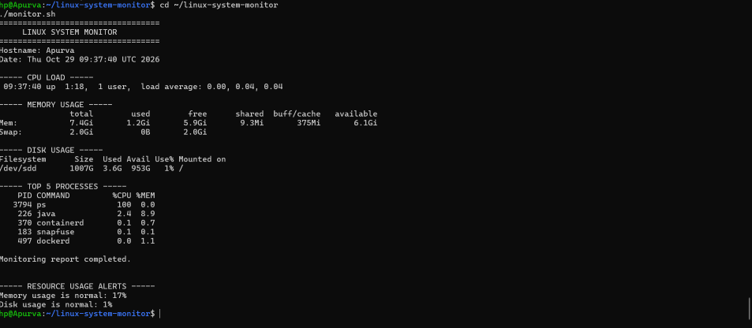

# Linux System Monitoring Tool

A beginner-friendly Linux system monitoring tool built
using Bash scripting.

## Overview

This project monitors basic Linux system information
and displays a report in the terminal. It also saves
monitoring output to a log file.


## Features

- Displays system hostname and current date
- Shows CPU load information
- Reports RAM usage
- Checks root filesystem disk usage
- Lists the top 5 CPU-consuming processes
- Generates warnings when memory usage reaches 80%
- Generates warnings when disk usage reaches 80%
- Saves monitoring reports to a local log file


## Technologies Used

- Linux
- Bash Shell Scripting
- Git
- GitHub

## Project Structure

linux-system-monitor/
├── monitor.sh
├── monitor.log
└── README.md

## Prerequisites

- Linux or Ubuntu on WSL
- Bash shell
- Standard Linux utilities

## How to Run

Clone the repository:

```bash
git clone https://github.com/apurva-patidar/linux-system-monitor.git
cd linux-system-monitor
```

Make the script executable:

```bash
chmod +x monitor.sh
```

Run the monitoring tool:

```bash
./monitor.sh
```

View the saved monitoring report:

```bash
cat monitor.log
```

## Learning Outcomes

- Understanding Bash scripting
- Using Linux monitoring commands
- Working with log files
- Practicing Git version control

## Future Improvements

- Add CPU usage percentage
- Add disk and memory usage alerts
- Generate timestamped reports
- Schedule monitoring with cron
## Sample Output

When the script runs, it displays a system monitoring report containing:

- **Hostname and Date:** Current system information
- **CPU Load:** System load averages
- **Memory Usage:** RAM usage in human-readable format
- **Disk Usage:** Root filesystem storage usage
- **Top Processes:** Five processes consuming the most CPU
- **Resource Alerts:** Warnings when memory or disk usage reaches 80%
- **Log File:** Monitoring reports are saved locally in `monitor.log`

### Run the Script

```bash
./monitor.sh
```

### Example Alert Messages

```text
----- RESOURCE USAGE ALERTS -----
Memory usage is normal: 45%
Disk usage is normal: 62%
```

*Note: The percentages above are illustrative examples. Actual values depend on your system.*


## Author

**Apurva Patidar**

Aspiring DevOps Engineer | Linux & Bash Scripting Enthusiast

- GitHub: [@apurva-patidar](https://github.com/apurva-patidar)
- Project: Linux System Monitoring Tool

This project was created to strengthen my practical
knowledge of Linux commands, Bash scripting, and
system monitoring as part of my DevOps learning journey.

## License

This project is licensed under the [MIT License](LICENSE).

You are free to use, modify, and distribute this project according to the license terms.
## Project Screenshot

The following screenshot shows the Linux System Monitoring Tool running in Ubuntu.


